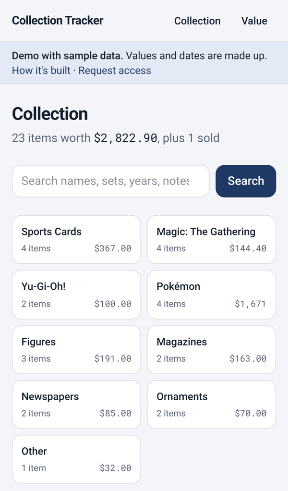
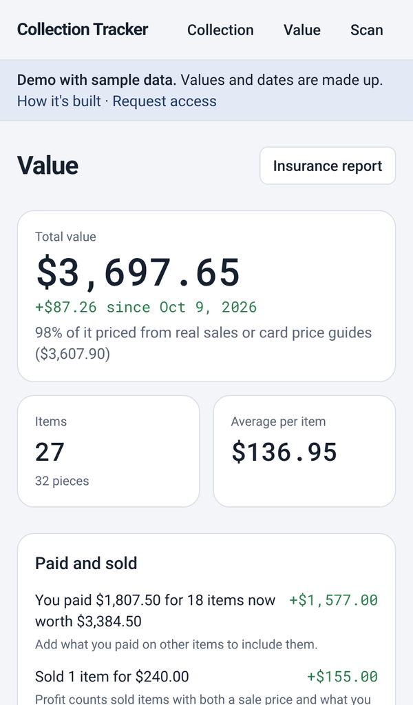
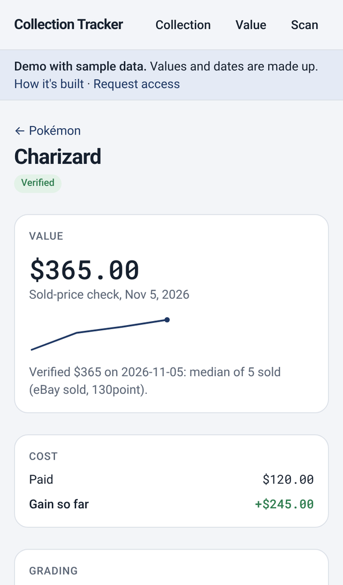

# Collection Tracker

A phone-first web app for cataloging and valuing collectibles: sports cards, Magic: The Gathering, Yu-Gi-Oh!, Pokémon, figures, magazines, newspapers, ornaments, and more.

**[Try the demo](https://jonathanwmendez-collection-tracker.vercel.app/demo)** (sample data, no sign-in).

<p>
  
  
  
</p>

## How it works

A Google Sheet is the main copy of the collection. Three pieces work on it:

| Piece | Runs on | What it does |
|---|---|---|
| **Collection Intake** | A Claude artifact | Take photos (or pick them from your library) and you're done. They upload to a Drive inbox. No Claude usage |
| **Background task** | A Claude scheduled task, nightly at 3:30 AM | Identifies new photos (pairs card fronts with backs, splits binder pages), checks for duplicates, saves each item to the sheet with a "Check this" note when unsure, and then prices it from recent sold listings. It also rechecks prices older than the repricing window (30 days by default) until 8:00 AM, adds PSA 9 and PSA 10 prices for ungraded cards, emails alerts for big moves, and logs each run with tokens used to a Price Log tab |
| **This web app** | Vercel + Supabase | Syncs from the sheet every morning and whenever you open it, to browse, search, edit, analyze, and share the collection |

Identifying and pricing run inside Claude, on a Claude subscription. The web app makes no paid AI calls.

**App features:**
- Collection: search, category lists with filters, item pages with full-screen photos (cards show front and back) and price history, and a list of items Claude flagged to check
- Editing saved to the sheet (each write checks it still has the right row), delete, queue for repricing, add without a photo with a duplicate check
- Profit tracking: what you paid, what you sold for, gain so far, and realized profit
- Value dashboard: total over time (snapshot every morning), change by category, biggest price moves, grading candidates, price upkeep, CSV export
- Free card prices for Magic, Pokémon, and Yu-Gi-Oh! (Scryfall, Pokémon TCG API, YGOPRODeck)
- Settings kept the same in the app and the sheet: repricing window, alert threshold, grading cost
- Invite-only accounts with an Admin page and a setup checklist for each new person, and view-only share links

**Built with:** Next.js 15, TypeScript, Tailwind CSS, Supabase (Postgres, Auth, Storage), Google Sheets and Drive APIs, Vercel.

## Setup

About 30 minutes. Do the steps in order: each one uses an address from the one before. Checked against each service in November 2026.

**You need:** a Google account, a GitHub account, free Supabase and Vercel accounts, and a Claude plan with scheduled tasks and artifacts. In Claude (**Settings > Connectors**), connect:

| Connector | Used by | For |
|---|---|---|
| Google Sheets | Setup, background task | Reading and writing the sheet |
| Google Drive | Setup, Collection Intake, background task | Photo folders, uploads, and reading photos |
| Gmail | Background task | Price alert emails. Optional: without it, alerts go in the Price Log tab instead |
| Supabase | Setup | Optional. Runs the database migrations for you (create the Supabase project in step 2.1 first) |
| Vercel | Setup | Optional. Creates the Vercel project and adds the variables that aren't secret |

Google Cloud has no connector. If Claude can use a browser where you're signed in to Google Cloud (such as Claude in Chrome), the setup prompt does step 3 for you, except copying the client secret.

### 1. Claude

Paste [`claude/SETUP.md`](claude/SETUP.md) into a new Claude conversation, after filling in your time zone where the prompt asks for it. It creates the sheet, photo folders, the background task, and Collection Intake, and gives you the sheet and Intake links for step 6.

### 2. Supabase

1. Create a project at [supabase.com](https://supabase.com). Under **Security**: keep **Enable Data API** on, turn **Automatically expose new tables** off, turn **Enable automatic RLS** on.
2. **SQL Editor:** run the files in [`supabase/migrations/`](supabase/migrations) in order, `0001` through `0010`. Skip this if Claude already ran them in step 1 with the Supabase connector.
3. **Settings > API Keys:** copy the project URL, a publishable key, and a secret key.

### 3. Google Cloud

If Claude did this in step 1, skip to step 4. You still need the client secret you copied.

1. In [Google Cloud Console](https://console.cloud.google.com), create a project and enable the **Google Sheets API** and **Google Drive API**.
2. **Google Auth Platform > Get started:** app name, support email, audience **External**, contact email.
3. **Audience > Test users:** add your Google account. Leave the status on **Testing**.
4. **Data access > Add or remove scopes > Manually add scopes:** paste the two scopes below, then **Add to table**, **Update**, **Save**.
   ```
   https://www.googleapis.com/auth/spreadsheets
   https://www.googleapis.com/auth/drive.readonly
   ```
5. **Clients > Create client**, type **Web application**. Leave the origins for now. Under **Authorized redirect URIs**, add `https://<project-ref>.supabase.co/auth/v1/callback` (your Supabase URL plus `/auth/v1/callback`). Copy the client ID and secret. Google may show the secret only once.

### 4. Vercel

1. At [vercel.com](https://vercel.com), **Add New > Project** and import this repository.
2. Add the environment variables below, then deploy. If Claude created the project in setup step 1, skip 4.1. Claude's last message lists the variables it added. Add the rest (at least `SUPABASE_SECRET_KEY` and `GOOGLE_CLIENT_SECRET`) and redeploy. Note the address, like `https://collection-tracker-xxxx.vercel.app`.
3. Back in the Google client from step 3.5, add that address under **Authorized JavaScript origins**.

| Variable | Value |
|---|---|
| `NEXT_PUBLIC_SUPABASE_URL` | Supabase project URL |
| `NEXT_PUBLIC_SUPABASE_PUBLISHABLE_KEY` | Supabase publishable key |
| `SUPABASE_SECRET_KEY` | Supabase secret key |
| `ADMIN_EMAILS` | Your Google account (the owner). Comma-separate to add more owners |
| `GOOGLE_CLIENT_ID` | Google client ID |
| `GOOGLE_CLIENT_SECRET` | Google client secret |
| `CRON_SECRET` | A long random string. Vercel sends it to the daily sync so only Vercel can run it |
| `POKEMONTCG_API_KEY` | Optional, raises the Pokémon price lookup limit ([pokemontcg.io](https://pokemontcg.io)) |

If you change a variable later, redeploy for it to take effect.

To use a different `.vercel.app` address, add it under **Settings > Domains**. Then put the new address in three places: Supabase's Site URL, Supabase's Redirect URLs (with `/auth/callback`), and the Google client's Authorized JavaScript origins. Share links made on the old address stop working unless you redirect it (see `vercel.json`).

### 5. Supabase sign-in

1. **Authentication > Sign In / Providers > Google:** turn it on, paste the Google client ID and secret, save.
2. **Authentication > URL Configuration:** Site URL = your Vercel address. Redirect URLs = `https://<your-vercel-address>/auth/callback`.

### 6. First sign-in

Open your Vercel address and sign in with Google. You'll see "Google hasn't verified this app": choose **Continue** and allow access. The setup checklist opens: paste the sheet and Collection Intake links from step 1 and save. The first sync starts on its own.

## Adding people

Everyone uses their own Google account and their own Claude plan. Their data stays separate.

1. They open the app and use **Request access** on the login page, or you invite them on the **Admin** page (Settings > Open Admin).
2. Approve or invite them on the Admin page. Then add their email under **Google Auth Platform > Audience > Test users**. Google doesn't let apps change that list, so the Admin page links to it.
3. They sign in, and the setup checklist walks them through the rest, including a button that copies the Claude setup prompt.

The Admin page shows each person's progress (signed in, Google, sheet, Intake, synced) and lets you make admins or remove access. Anyone can delete their own account and app data from Settings.

**About Testing mode:** up to 100 test users can sign in, and Google asks everyone to sign in again every 7 days. Publishing the app removes both limits, but Google requires a verified domain with a privacy policy and terms, plus a review of both scopes, including a yearly third-party security assessment for `drive.readonly`.

## Sharing

**Collection > Share** creates view-only links. For each link, pick the categories, whether values and notes show, and when it expires. Anyone with the link can browse, search, and open items without an account, and tap a photo to see it full screen (swipe between photos, pinch to zoom). Links never expose the sheet, Drive links, or anything else in your Google account. The Share page shows each link's views, and **Turn off** disables it for good.

## Development

```bash
npm install
cp .env.example .env.local   # fill in the values from the table
npm run dev                  # http://localhost:3000
npm test
```

For local sign-in, also add `http://localhost:3000` to the Google client's JavaScript origins and `http://localhost:3000/**` to Supabase's redirect URLs.

| Path | What's there |
|---|---|
| `src/lib/sheet-format.ts` | Reading and writing sheet rows. Columns are found by header, so they can move |
| `src/lib/sheets.ts` | Google Sheets API calls, including the settings on the Summary tab |
| `src/lib/sync.ts` | Sheet-to-database sync, price history, daily value snapshots (also run every morning by `src/app/api/cron/sync`) |
| `src/lib/collection.ts`, `src/lib/movers.ts` | Totals, gains, grading math, and biggest price changes |
| `src/components/value-dashboard.tsx` | The Value page, shared with the demo |
| `src/lib/demo-data.ts`, `src/app/demo/` | The public demo with sample data |
| `src/lib/csv.ts` | CSV export |
| `src/lib/item-sheet.ts` | Safe row writes that check the row first |
| `src/lib/prices.ts` | Free card price lookups |
| `src/lib/access.ts` | Owners, invites, and roles |
| `src/lib/shares.ts`, `src/app/s/` | Share links and the public view-only pages |
| `src/app/api/` | Sync, daily sync, item edit/delete/reprice/price, settings, export, access requests, admin, account deletion, photo previews |
| `supabase/migrations/` | Tables: items, photos, price_checks, value_snapshots, settings, google_tokens, members, access_requests, shares |
| `claude/` | Setup prompt, Collection Intake page, and the background task prompt (`price-check.md`) |
| `vercel.json` | Daily sync schedule, and a redirect from this deployment's old address (safe to remove in a fork) |
| `tests/` | Unit tests for row parsing, price lookups, access and share rules, collection math, and CSV export |

## Security

- Only owners (`ADMIN_EMAILS`) and invited accounts can sign in, and every table uses row-level security, so each person sees only their own data.
- Invites and access requests live in tables only the server can read.
- Share links use random 128-bit tokens, are checked on every request, and only serve the categories and fields the link allows. Share pages are hidden from search engines.
- Google refresh tokens live in a table only the server can read.
- Google access: the app asks to edit sheets and view Drive files. It only opens the connected sheet and the photos it links to, and never deletes anything in Drive. Deleting your account also revokes the app's Google access.
